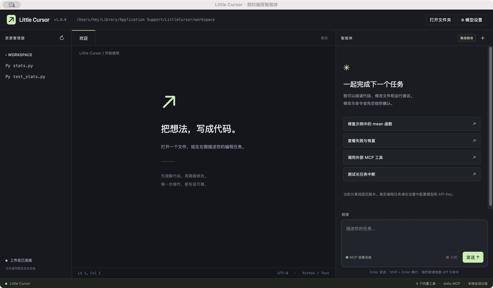
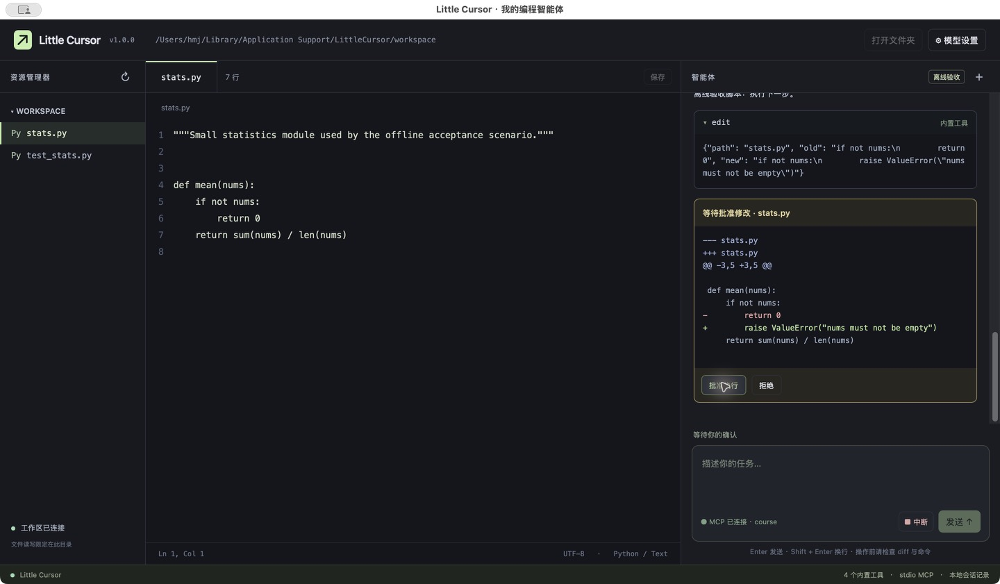
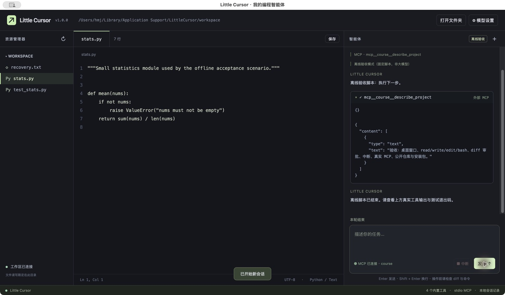

# Little Cursor

一个用 Python 编写的桌面编程智能体。左侧浏览文件，中间查看和编辑代码，右侧与模型对话、查看工具结果、审批 diff 与命令。

v1.0.1 增加 DeepSeek 官方接口兼容和更明确的 API 错误提示，操作见 [DeepSeek 接入说明](docs/deepseek.md)。先使用自己的 Key 验证真实连接，再做现场任务。此更新已经通过 21 项自动测试，其中 DeepSeek 多轮工具调用使用模拟接口验收，尚未完成个人账户真实服务验收。

## 三步启动

1. 从 [Releases](https://github.com/huaminjie528-star/python-/releases) 下载适用于 Apple Silicon 的 `.dmg`，打开磁盘映像，把 **Little Cursor.app** 复制到应用程序文件夹。
2. 双击打开应用。先使用默认的离线验收模式，点击“修复示例中的 mean 函数”，逐次批准测试命令和 diff。
3. 处理自己的任务时，打开“模型设置”，选择“真实大模型”，填写支持 Chat Completions 工具调用的 API Base URL、模型名与 Key，再用“打开文件夹”选择项目。

离线模式是明确标注的固定测试脚本，**不会理解任意需求**。现场随机题需要切换真实模型。Key 仅存后端内存，退出后清除。安装包为本机构建的 arm64 版本，无 Apple 开发者签名或公证；其他电脑可能受 Gatekeeper 限制，不能视为已经跨机验证。运行项目自己的 Python/Node/测试命令仍需要相应开发环境。

## 界面





## 实现内容

- `read(path, offset, limit)`：1 起始行号、分页、剩余行数，PNG/JPEG/GIF/WebP 返回图像块。
- `write(path, content)`：自动建目录，临时文件、fsync、原子 rename，报告修改前后行数。
- `edit(path, old, new)`：精确字符串替换，仅允许出现一次，失败回灌模型。
- `bash(command, timeout)`：stdout、stderr、退出码，超时、输出截断、进程组中断。非零退出也正常返回并标红。
- 大模型自主选择下一步，工具结果回灌，多轮任务保留上下文。最多 20 步（代码硬上限 40），60 次工具调用，240 秒整体预算，重复同一调用 3 次后停止。
- 所有模型写入和 shell 命令先审批。后端只监听 `127.0.0.1`，请求要求随机会话令牌。
- MCP 使用独立 stdio 子进程，执行 initialize、initialized、tools/list、tools/call，界面以“外部 MCP”标识。
- 事件流与逐次工具记录保存到 `~/Library/Application Support/LittleCursor/`。新会话清空模型上下文。重启保留日志文件，不自动恢复对话。

文件读写会拒绝工作区外路径与敏感目录，**bash 和第三方 MCP 仍有当前用户权限**，不是系统沙箱。仅在信任的项目上运行，执行前核对命令。工具日志可能包含项目代码，请自行管理。

## 从源码运行

在 macOS 安装 Python 3.9+，然后依次执行：

```bash
python3 -m venv .venv
.venv/bin/python -m pip install -r requirements-lock.txt
.venv/bin/python app.py
```

本次构建使用 Python 3.9.6、macOS 15.5、Apple Silicon。全部已解析依赖在 `requirements-lock.txt` 钉死。Linux/Windows 桌面兼容与安装包尚未验证。

## 后端可以独立运行

```bash
python3 -m server.app --workspace examples/demo_workspace --port 8765
```

启动时打印带随机 token 的本地 URL。把该 token 放到下面变量，第二个终端启动任务，再通过 `curl -N` 看 SSE；无需打开前端。SSE 是这里的实时传输方案，未使用 FastAPI/WebSocket。

```bash
AGENT_TOKEN='复制本机启动输出中的 token'
curl -s -H "X-Agent-Token: $AGENT_TOKEN" -H 'Content-Type: application/json' \
  -d '{"task":"调用 MCP 获取验收清单"}' http://127.0.0.1:8765/api/task
# 将上一条返回的 job 值填到 JOB_ID
JOB_ID='上一条返回的 job'
curl -N -H "X-Agent-Token: $AGENT_TOKEN" "http://127.0.0.1:8765/api/events?job=$JOB_ID"
```

涉及写入和命令的任务会出现 `approval` 事件，用 `/api/approve` POST `{"job":"...","approval_id":"...","allow":true}` 批准。`/api/cancel` POST `{"job":"..."}` 中断。日志中应能看到 `mcp`、`tool_start`、`tool_result`、`done`。

## 测试、打包与材料

```bash
python3 -m unittest discover -s tests -v
python3 scripts/collect_trace.py
bash scripts/build_macos.sh
```

测试覆盖四工具、失败恢复、真实 MCP 子进程、HTTP 鉴权、Key 不落盘、模拟模型服务端的工具调用往返。模拟模型测试不代表已连接收费模型服务。打包产物在 `release/`，源码无需上传虚拟环境和构建缓存。

- [课程报告](report.md)
- [实际运行记录](docs/trace.md)
- [构建说明](docs/build.md)
- [五分钟演示提纲](docs/demo.md)
- [作业要求逐项对照](docs/checklist.md)
- `demo.mp4` 在 Release 附件中：安装版实际操作的截图采样回放，无配音，画面明确标注离线验收。它展示四工具、审批、MCP 与中断，不是现场随机题的真实模型录像。

开发记录从 2026-10-28 开始，尚不满足课件要求的“≥15 次 commit，跨度 ≥7 天”。应继续进行真实迭代并提交，不回填日期或人为拆分提交凑数。
